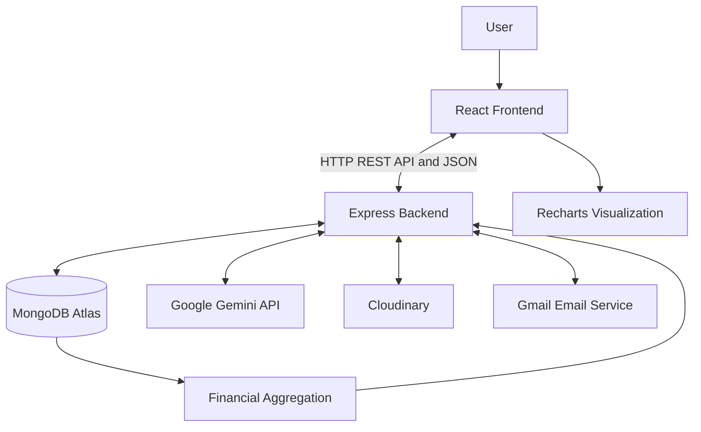
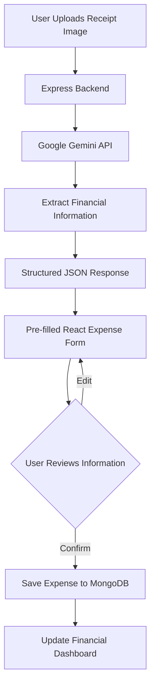
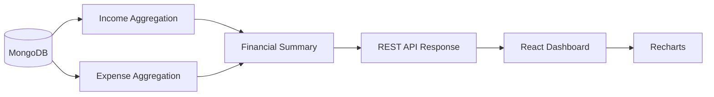
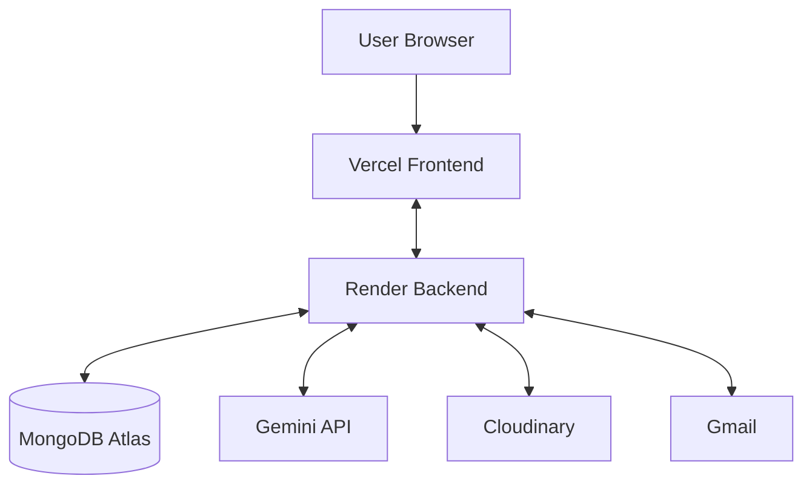

# SpendWise AI

### AI-Powered Personal Finance Management


## Overview

SpendWise AI is a full-stack personal finance management application designed to simplify expense tracking, income management and financial analysis through AI-assisted receipt scanning and interactive dashboards.

Traditional expense trackers require users to manually enter transaction details, which can be time-consuming. SpendWise AI addresses this problem by integrating Google's Gemini API to extract structured financial information from receipt images and automatically populate expense forms.

Users can review, modify and confirm the extracted information before saving transactions, ensuring greater control over AI-generated data.

The application combines responsive frontend development, REST API integration, authentication, cloud deployment, database management and artificial intelligence.

## Live Application

🔗 [Explore SpendWise AI](https://spendwise-ai-roan.vercel.app)

## Project Highlights

- Full-stack application developed using the MERN stack.
- AI-assisted receipt scanning using Google Gemini API.
- Successfully processed 35 out of 35 test receipts.
- Interactive financial dashboards and data visualization.
- Secure JWT-based authentication using HTTP-only cookies.
- User-specific income and expense management.
- Parallel MongoDB aggregation for financial analytics.
- CSV export functionality.
- Responsive interface with light and dark themes.
- Cloud-based image storage using Cloudinary.
- Frontend and backend deployment using Vercel and Render.

---

## Table of Contents

- [Features](#features)
- [Technology Stack](#technology-stack)
- [System Architecture](#system-architecture)
- [AI Receipt Processing Workflow](#ai-receipt-processing-workflow)
- [AI Receipt Scanning Evaluation](#ai-receipt-scanning-evaluation)
- [Database and Analytics](#database-and-analytics)
- [Security and Error Handling](#security-and-error-handling)
- [Project Structure](#project-structure)
- [Getting Started](#getting-started)
- [Environment Variables](#environment-variables)
- [Deployment](#deployment)
- [Testing](#testing)
- [Known Limitations](#known-limitations)
- [Future Enhancements](#future-enhancements)
- [Key Learnings](#key-learnings)
- [Author](#author)

---

## Features

### 1. Authentication and User Management

- User registration, login and logout.
- Password hashing using bcrypt.
- JWT-based authentication.
- HTTP-only cookies for token storage.
- Persistent authentication after page refresh.
- Password recovery through email.
- Password reset links with a 15-minute expiration period.
- Profile image uploads using Cloudinary.
- Protected routes for authenticated users.
- Rate limiting for sensitive operations.

### 2. Expense Management

- Create new expense records.
- View existing expenses.
- Update transaction information.
- Delete expense records.
- Organize expenses using categories.
- Store merchant information.
- Attach receipt images to transactions.
- Support both manual and AI-assisted expense creation.
- Export expense records as CSV files.

### 3. Income Management

- Add new income records.
- View income history.
- Update and delete income records.
- Export income records as CSV files.
- Monitor income trends through visual dashboards.

### 4. Financial Analytics Dashboard

The application provides an interactive dashboard that helps users understand their financial activities.

Dashboard features include:

- Total balance.
- Total income.
- Total expenses.
- Monthly spending trends.
- Category-wise expense distribution.
- Income versus expense comparison.
- Income trend visualization.

MongoDB aggregation pipelines are used to calculate financial summaries, while Recharts is used to present the results through interactive visualizations.

### 5. AI-Powered Receipt Scanning

The application uses Google Gemini API to extract financial information from uploaded receipt images.

The extracted information includes:

| Field | Description |
|---|---|
| Merchant | Name of the merchant or business |
| Amount | Transaction amount |
| Date | Date of the transaction |
| Category | Suggested expense category |

Extracted information is used to automatically populate the expense form.

Users can manually correct inaccurate or missing information before confirming the transaction.

Unreadable fields are returned as null rather than forcing an uncertain value into the expense record.

### 6. Responsive User Interface

- Sidebar-based navigation.
- Dashboard, income and expense pages.
- Interactive charts and financial summaries.
- Responsive layouts for different screen sizes.
- Light and dark themes.
- Persistent theme preferences.
- User-friendly forms and navigation.

---

## Technology Stack

### Frontend

| Technology | Purpose |
|---|---|
| React.js | Component-based user interface |
| JavaScript | Frontend application logic |
| Vite | Frontend development and build tooling |
| React Router | Client-side navigation |
| Axios | Backend API communication |
| Recharts | Financial data visualization |
| HTML5 and CSS3 | Interface structure and styling |

### Backend

| Technology | Purpose |
|---|---|
| Node.js | JavaScript runtime |
| Express.js | REST API development |
| Mongoose | MongoDB object modeling |
| JSON Web Token | Authentication |
| bcrypt | Password hashing |
| Multer | File upload handling |
| Nodemailer | Email-based password recovery |
| Helmet | HTTP security headers |
| express-rate-limit | API rate limiting |

### Artificial Intelligence and Database

| Technology | Purpose |
|---|---|
| Google Gemini API | Receipt image analysis and information extraction |
| MongoDB | Financial and user data storage |
| MongoDB Aggregation | Financial analytics |
| MongoDB Atlas | Cloud database hosting |
| Cloudinary | Image storage and management |

### Deployment and Development Tools

| Technology | Purpose |
|---|---|
| Vercel | Frontend hosting |
| Render | Backend hosting |
| MongoDB Atlas | Cloud database |
| Git | Version control |
| GitHub | Source code management |

---

## System Architecture

SpendWise AI follows a client-server architecture, separating the user interface, application logic, database and external services.



### Frontend Layer

The React frontend manages:

- User interactions.
- Component rendering.
- Client-side navigation.
- Authentication state.
- Financial forms.
- Receipt uploads.
- Dashboard visualizations.
- Communication with backend REST APIs.

### Backend Layer

The Express backend handles:

- HTTP requests and responses.
- Authentication and authorization.
- Business logic.
- Financial transaction management.
- Receipt processing.
- Database operations.
- External service integration.
- Error handling.

### Backend Application Structure

The backend follows a layered architecture.

| Layer | Responsibility |
|---|---|
| Routes | Define API endpoints and HTTP methods |
| Middleware | Authentication, uploads, rate limiting and error handling |
| Controllers | Implement application business logic |
| Models | Define database schemas |
| Services | Handle Gemini receipt extraction |
| Utilities | Reusable response, error and email functions |
| Configuration | Database and external service connections |

### Database Layer

MongoDB stores user accounts, income records and expense records.

Financial information is associated with individual users to prevent unauthorized access to other users' transactions.

### External Services

- Gemini API for receipt image analysis.
- Cloudinary for image management.
- Gmail through Nodemailer for password recovery.

---

## AI Receipt Processing Workflow

The receipt scanning feature reduces manual data entry by converting receipt images into structured financial information.



### Processing Steps

1. The user selects and uploads a receipt image.
2. The frontend sends the image to the backend.
3. The backend processes the upload and invokes the Gemini API.
4. Gemini analyzes the receipt and extracts financial information.
5. The extracted information is returned as structured JSON.
6. The frontend automatically populates the expense form.
7. The user reviews and corrects the extracted values.
8. After confirmation, the transaction is saved in MongoDB.
9. The updated transaction contributes to the financial dashboard.

### Example AI Response

The following is an illustrative representation of the extracted information.

```json
{
  "merchant": "Sample Supermarket",
  "amount": 1250.50,
  "date": "2026-11-20",
  "category": "Groceries"
}
```

### Human-in-the-Loop Validation

The application does not automatically save AI-generated financial information.

Instead, users can:

- Review extracted merchant information.
- Verify the transaction amount.
- Correct the transaction date.
- Change the suggested category.
- Fill in missing information.
- Confirm the transaction before saving.

This approach reduces the impact of incorrect or incomplete AI-generated results.

---

## AI Receipt Scanning Evaluation

The receipt scanning functionality was evaluated using a test dataset of 35 receipt images.

### Evaluation Results

| Evaluation Metric | Result |
|---|---:|
| Total receipts tested | 35 |
| Successfully processed receipts | 35 |
| Failed receipt processing attempts | 0 |
| Processing success rate | 100% |

All 35 test receipts were successfully processed through the AI-assisted receipt scanning workflow.

### Evaluation Summary

- Successfully processed 35/35 test receipts.
- Reduced the need for manual transaction entry.
- Provided structured information for expense form completion.
- Supported manual review and correction of AI-generated values.

### Evaluation Limitations

The results represent processing success on a limited dataset of 35 receipts.

A successful processing result does not necessarily indicate that every extracted field is completely accurate.

Further evaluation is required to measure:

- Merchant name extraction accuracy.
- Transaction amount extraction accuracy.
- Date extraction accuracy.
- Category prediction accuracy.
- Performance on low-quality images.
- Performance across different receipt formats.
- Average receipt processing time.

---

## Database and Analytics

### Database Management

The application uses MongoDB and Mongoose to manage user accounts and financial transaction records.

Expense records support both manually entered and AI-assisted transactions.

Receipt-related information includes:

| Field | Purpose |
|---|---|
| source | Identifies manual or receipt-based expense creation |
| receiptImageUrl | Stores the receipt image reference |
| merchant | Stores merchant information |

### Financial Aggregation

MongoDB aggregation pipelines are used to calculate financial summaries directly from stored transaction data.

Expense and income aggregation operations are executed concurrently using JavaScript Promise.all.

The aggregated results are returned to the frontend and displayed through financial dashboards.

### Analytics Workflow



### Financial Calculations

The application supports:

- Total income calculation.
- Total expense calculation.
- Available balance calculation.
- Monthly income analysis.
- Monthly expense analysis.
- Expense category distribution.
- Income and expense comparisons.

Available balance is calculated as:

```text
Available Balance = Total Income - Total Expenses
```

---

## Security and Error Handling

### Authentication and Security

The application includes the following security mechanisms:

- Password hashing using bcrypt.
- JWT-based authentication.
- HTTP-only authentication cookies.
- Protected backend endpoints.
- User-specific database queries.
- Rate limiting on sensitive operations.
- HTTP security headers using Helmet.
- Restricted CORS configuration.
- Expiring password reset tokens.
- Environment variables for sensitive configuration.

### Error Handling

The backend uses centralized error handling to provide consistent API responses.

Reusable utilities include:

- ApiError
- ApiResponse
- asyncHandler

An illustrative error response is shown below:

```json
{
  "success": false,
  "message": "Unable to process the request",
  "statusCode": 400
}
```

Centralized error handling improves maintainability and provides a consistent mechanism for communicating backend errors to the frontend.

---

## Project Structure

```text
expense-tracker/
│
├── backend/
│   ├── config/
│   ├── controllers/
│   ├── middleware/
│   ├── models/
│   ├── routes/
│   ├── scripts/
│   ├── services/
│   ├── utils/
│   └── server.js
│
├── frontend/
│   └── src/
│       ├── api/
│       ├── components/
│       ├── context/
│       ├── pages/
│       └── utils/
│
├── .gitignore
└── README.md
```

---

## Getting Started

### Prerequisites

Before running the application locally, ensure that you have:

- Node.js and npm.
- Git.
- MongoDB Atlas account and database connection.
- Google Gemini API key.
- Cloudinary account.
- Gmail account with an app password for email functionality.

### 1. Clone the Repository

```bash
git clone https://github.com/pratiyadav/expense-tracker.git
cd expense-tracker
```

### 2. Backend Setup

Navigate to the backend directory.

```bash
cd backend
```

Install dependencies.

```bash
npm install
```

Create a backend environment file using the provided .env.example file.

For Windows PowerShell:

```powershell
Copy-Item .env.example .env
```

For Linux or macOS:

```bash
cp .env.example .env
```

Configure the required environment variables.

Start the backend server.

```bash
npm run dev
```

The default backend API URL is:

```text
http://localhost:5000/api
```

### 3. Frontend Setup

Open another terminal from the project root.

```bash
cd frontend
npm install
```

Create a .env file inside the frontend directory if a custom backend URL is required.

```env
VITE_API_URL=http://localhost:5000/api
```

Start the frontend development server.

```bash
npm run dev
```

Open the URL displayed in the terminal to access the application.

The default Vite development URL is generally:

```text
http://localhost:5173
```

### 4. Running the Application

Both the frontend and backend servers must be running simultaneously.

```text
Terminal 1: Backend
npm run dev

Terminal 2: Frontend
npm run dev
```

---

## Environment Variables

### Backend Environment Variables

Create a .env file inside the backend directory.

```env
PORT=5000
NODE_ENV=development
CLIENT_URL=http://localhost:5173

MONGO_URI=your_mongodb_connection_string
JWT_SECRET=your_secure_jwt_secret

CLOUDINARY_CLOUD_NAME=your_cloudinary_cloud_name
CLOUDINARY_API_KEY=your_cloudinary_api_key
CLOUDINARY_API_SECRET=your_cloudinary_api_secret

GEMINI_API_KEY=your_gemini_api_key

EMAIL_USER=your_gmail_address
EMAIL_PASS=your_gmail_app_password
```

The following optional variable can be used to configure the Gemini model:

```env
GEMINI_MODEL=your_supported_gemini_model
```

### Environment Variable Reference

| Variable | Description |
|---|---|
| PORT | Backend server port |
| NODE_ENV | Application environment |
| CLIENT_URL | Authorized frontend URL |
| MONGO_URI | MongoDB database connection string |
| JWT_SECRET | JWT signing secret |
| CLOUDINARY_CLOUD_NAME | Cloudinary account name |
| CLOUDINARY_API_KEY | Cloudinary API key |
| CLOUDINARY_API_SECRET | Cloudinary API secret |
| GEMINI_API_KEY | Google Gemini API key |
| GEMINI_MODEL | Optional Gemini model configuration |
| EMAIL_USER | Gmail account address |
| EMAIL_PASS | Gmail app password |

### Frontend Environment Variable

```env
VITE_API_URL=http://localhost:5000/api
```

Never commit actual environment variables, credentials, database connection strings or API keys to GitHub.

---

## Deployment

SpendWise AI uses separate cloud services for frontend hosting, backend hosting, database management and image storage.

| Component | Platform |
|---|---|
| Frontend | Vercel |
| Backend | Render |
| Database | MongoDB Atlas |
| Image Storage | Cloudinary |
| AI Service | Google Gemini API |



### Production Configuration

- Configure the frontend API URL using VITE_API_URL.
- Configure backend environment variables on Render.
- Set NODE_ENV to production.
- Set CLIENT_URL to the deployed frontend URL.
- Use secure cookie configuration for production.
- Configure MongoDB Atlas network access appropriately.
- Store external service credentials securely.

The Vercel routing configuration supports client-side navigation and allows React Router pages to work correctly after a browser refresh.

---

## Testing

### AI Receipt Processing

The AI receipt scanning workflow has been evaluated on 35 receipt images, with all 35 successfully processed.

### Functional Testing Scope

The following scenarios provide a checklist for manual application testing.

| Test ID | Test Scenario | Expected Result |
|---|---|---|
| TC01 | User registration | Account is created successfully |
| TC02 | Valid login | User accesses the dashboard |
| TC03 | Invalid login | Appropriate error is displayed |
| TC04 | Add expense | Expense record is created |
| TC05 | Edit expense | Existing expense is updated |
| TC06 | Delete expense | Selected expense is removed |
| TC07 | Add income | Income record is created |
| TC08 | Edit income | Existing income is updated |
| TC09 | Delete income | Selected income is removed |
| TC10 | Receipt upload | Receipt image is processed |
| TC11 | AI receipt extraction | Expense form receives extracted information |
| TC12 | Manual receipt correction | User can modify extracted values |
| TC13 | CSV export | Transaction data is exported |
| TC14 | Dark and light themes | Selected theme is applied |
| TC15 | Responsive layout | Interface adapts to different screen sizes |
| TC16 | Unauthorized API access | Protected resource access is denied |
| TC17 | Password recovery | Password reset workflow is initiated |
| TC18 | Financial calculations | Dashboard displays correct totals |

The table describes the intended testing scope and expected behavior. It is not a record of completed or passed test cases.

Automated unit, integration and end-to-end tests are planned as future improvements.

---

## Known Limitations

- Automated unit and integration tests have not yet been implemented.
- Current input validation covers basic application requirements.
- Financial transaction lists do not currently support pagination.
- Additional CSRF protection is not yet implemented.
- Receipt extraction quality depends on image clarity and receipt format.
- Receipt processing has been evaluated on a limited dataset of 35 images.
- Field-level AI extraction accuracy requires further quantitative evaluation.
- Receipt scanning depends on the availability of the external Gemini API.

---

## Future Enhancements

### Frontend Improvements

- Migrate suitable frontend components to TypeScript.
- Introduce reusable and maintainable UI components.
- Implement frontend testing using Vitest and React Testing Library.
- Improve loading, validation, success and error states.
- Introduce TanStack Query for API state management and caching.
- Improve keyboard navigation and accessibility.
- Support internationalization and multiple languages.
- Introduce advanced transaction filtering and searching.

### Backend Improvements

- Implement automated API tests using Jest and Supertest.
- Improve request validation and sanitization.
- Add pagination for transaction lists.
- Introduce additional CSRF protection.
- Improve structured logging and monitoring.
- Implement CI/CD pipelines using GitHub Actions.
- Improve API documentation.

### AI Improvements

- Expand the receipt evaluation dataset.
- Measure field-level extraction accuracy.
- Evaluate receipts with different layouts and image quality.
- Analyze receipt processing latency.
- Introduce AI-assisted spending insights.
- Explore intelligent budgeting recommendations.
- Improve automatic expense categorization.

### Additional Product Features

- Monthly budget planning.
- Financial goal tracking.
- Recurring expense management.
- Advanced financial reporting.
- Personalized spending recommendations.

---

## Key Learnings

Developing SpendWise AI provided practical experience in:

- End-to-end full-stack application development.
- React component-based interface development.
- Frontend and backend communication using REST APIs.
- Working with structured JSON responses.
- Integrating AI capabilities into existing application workflows.
- Human-in-the-loop validation of AI-generated information.
- Database modeling and MongoDB aggregation.
- Authentication and authorization.
- Financial data visualization.
- File uploads and cloud-based image management.
- Application debugging and error handling.
- Responsive interface development.
- Cloud deployment and environment configuration.
- Technical documentation and version control.

The project demonstrates how artificial intelligence can be integrated into a practical business application to improve user experience and reduce repetitive manual tasks.

---

## Author

**Pratibha Yadav**

Master of Computer Applications (2025–2027)  
University of Hyderabad

- 🔗 [GitHub](https://github.com/pratiyadav)
- 🔗 [Portfolio](https://pratibha-portfolio-ecru.vercel.app)
- 🔗 [Live Application](https://spendwise-ai-roan.vercel.app)

---

## License

This project is developed for educational, learning and portfolio purposes.

---

If you find this project interesting, consider exploring the source code and live application.

**SpendWise AI — Simplifying personal finance through intelligent automation.**
